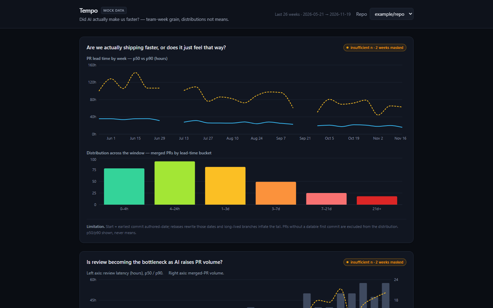

# Tempo



*The dashboard running on its built-in mock data (`npm run dev:mock`); every number shown is synthetic.*

Tempo is a self-hosted dashboard that answers one question with data instead of
vibes: **did AI actually make us faster?** It joins GitHub PR flow with
Claude Code AI-usage telemetry (Jira cycle time is planned) and reports
DORA-anchored trends and distributions --- p50/p90, never means, trends over
absolutes. **The design decision the whole project turns on: Tempo measures at
the team level and never the individual level, and that is enforced in the
schema, not just the prose.** Every serving query aggregates to team-week grain
through one derived table; there is no per-author endpoint and no per-author
capability, because individual measurement is not just an ethics problem --- it
is how metrics programs die (Goodhart's law). Tempo shows a team its own trends;
it cannot show, and was built so it *can never* show, a ranking of people.

This repository covers the first stage: GitHub -> metrics -> dashboard -> AI
telemetry. Pilot it on public repositories first --- public data only, so
there is no consent step, and it validates every metric formula end to end.

Tempo is a personal project, unaffiliated with any employer. Its current and
only scope is public open-source repositories; if any team ever pilots it on
private data, the consent design in "Privacy and ethics" below is the
non-negotiable prerequisite.

## Architecture

```
GitHub GraphQL ──(collectors/github.py)──► pull_requests / reviews / pr_commits ─┐
local bare clones ──(jobs/rework.py blame)──► rework                             ├─(jobs/rollup.py)──► metrics_team_week
Claude Code OTLP ──(api/otlp.py receiver)──► ai_usage_daily ─────────────────────┘            │
                                                              (api/serve.py) ◄────────────────┘  ──► frontend/
CLI: tempo init-db | sync-github | rework | rollup | serve
```

Postgres holds raw fact tables plus one nightly-recomputed rollup,
`metrics_team_week` --- **the only table the API serves.** No warehouse, no dbt;
it is one team's data.

## Quickstart

To just see the dashboard, with no database and no token, run it on the
built-in mock data:

```bash
cd frontend && npm install && npm run dev:mock
```

For real data, follow the steps below.

Prerequisites: Docker (Postgres + API), Python 3.12 with [`uv`](https://docs.astral.sh/uv/),
Node 20.19+ or 22.12+ for the dashboard. Copy `.env.example` to `.env` and set at least
`TEMPO_AUTHOR_SALT` (a long random string --- it stays out of the database) and
`GITHUB_TOKEN` (a fine-grained, read-only PAT: Pull requests read, Contents
read, Metadata read, scoped to the repos in `config/repos.yaml`).

```bash
# 1. Install the Python dependencies.
uv sync

# 2. Start Postgres (host port 5433).
docker compose up -d db

# 3. Create the schema.
uv run tempo init-db

# 4. Backfill 12 months of GitHub history for the configured repos, then
#    compute rework (git-blame line survival) and roll up the metrics.
uv run tempo sync-github --backfill-months 12
uv run tempo rework
uv run tempo rollup

# 5. Serve the API (port 8010) ...
uv run tempo serve --host 0.0.0.0 --port 8010

# 6. ... and the dashboard (proxies /api -> :8010).
cd frontend && npm install && npm run dev
```

Nightly, re-run `sync-github` (incremental, no flag), `rework`, and `rollup`
from host cron. Progress prints to stderr; stdout stays clean, so the CLI pipes
cleanly. In production, `docker compose up` runs Postgres and the API together;
run the jobs with `docker compose run --rm api tempo <cmd>`.

## What Tempo measures

Every chart carries its limitation as a footnote --- honesty is the point;
engineering managers spot overclaiming instantly. The footnotes below are the exact
strings shipped in `tempo/metrics/keys.py` (`LIMITATIONS`) and rendered on-chart.

| Metric | The question it answers | Limitation |
| --- | --- | --- |
| **PR lead time** (p50/p90, `pr_lead_time_p50_hours`, `pr_lead_time_p90_hours`, plus a 6-bucket histogram) | Are we actually shipping faster, or does it just feel that way? | Start = earliest commit authored-date; rebases rewrite those dates and long-lived branches inflate the tail. p50/p90 shown, never means. |
| **Review latency** (p50/p90, `review_latency_p50_hours`, `review_latency_p90_hours`) | Is review becoming the bottleneck as AI raises PR volume? | First non-author review only; re-review rounds are ignored, and a 4-minute rubber stamp counts the same as a real review. |
| **Revert rate** (`revert_rate`) | How often does merged code get pulled back out? | Detects explicit reverts only. A fix-forward culture hides failures from this metric entirely --- it is a floor, not a truth. |
| **Rework rate** (`rework_rate`) | Is the code we merge now actually surviving? | % of added lines modified or deleted again within 21 days. Refactors and formatting sweeps count as rework; 21 days is a chosen window, not a law. |
| **AI spend** (`ai_cost_usd`, `ai_tokens_total`) | Does spend correlate with speed --- anywhere, at all? | Spend attribution is repo-week level from opt-in resource tags; unattributed spend makes every per-repo figure a lower bound. |
| **Cost per merged PR** (`cost_per_merged_pr_usd`) | What does a merged PR cost now, tokens included? | An average over a coarse join (repo-week spend / merged PRs); unattributed spend makes it a lower bound. |

Slices backed by fewer than three distinct contributors are masked: the API
returns `value: null` and the dashboard renders "insufficient n" (the n-floor,
below).

### API

- `GET /healthz` -> `{"ok": true}`
- `GET /api/repos` -> `{"repos": [slug, ...]}`
- `GET /api/metrics?repo=<slug>&metrics=<csv, default all>&from=<date>&to=<date>`
  returns one series per metric, weeks ascending, `value: null` where the
  n-floor masks a slice. Unknown metric names return `422` listing the allowed
  keys.

## Claude Code telemetry (OTLP receiver)

The receiver at `POST /v1/metrics` accepts OTLP/HTTP **JSON** and consumes
exactly three metrics --- `claude_code.token.usage`, `claude_code.cost.usage`,
`claude_code.session.count` --- rolling them into `ai_usage_daily`. On each dev
machine (or in per-repo `.claude/settings.json` env):

```bash
export CLAUDE_CODE_ENABLE_TELEMETRY=1
export OTEL_METRICS_EXPORTER=otlp
export OTEL_EXPORTER_OTLP_PROTOCOL=http/json
export OTEL_EXPORTER_OTLP_ENDPOINT=http://<tailnet-host>:8010
export OTEL_EXPORTER_OTLP_METRICS_TEMPORALITY_PREFERENCE=delta   # also the client default
# Repo/team attribution (the supported mechanism for custom tags):
export OTEL_RESOURCE_ATTRIBUTES="repo=<owner>/<name>,team.id=<org_unit>"
# Optional, only if the server sets TEMPO_OTLP_TOKEN:
export OTEL_EXPORTER_OTLP_HEADERS="Authorization=Bearer <token>"
```

The receiver reads only the token/cost/session values and the `repo` / `team.id`
resource attributes. On `claude_code.token.usage` the datapoint `type` selects
the field --- `input` -> tokens_in, `output` -> tokens_out; `cacheRead` and
`cacheCreation` are excluded from the token counts but are already priced into
`claude_code.cost.usage`. Anything without a `repo` tag lands in
`repo='unattributed'` and is shown, not hidden. Both delta and cumulative
temporality are handled (cumulative counters are deltified server-side, counter
resets included). **The receiver is never exposed publicly --- tailnet/VPN only.**

## Privacy and ethics

Team-level-only is operationalized, not decorative:

**Never collected** --- not "not displayed", *not in the database*:
- PR/issue titles, bodies, diff contents, comments
- raw usernames or emails (author logins are HMAC-hashed at ingest, before any
  insert; the salt lives only in `.env`, never in the DB)
- per-person AI usage (OTLP identity attributes --- `user.id`, `user.email`,
  `user.account_uuid`, `session.id`, `organization.id` --- are dropped at the
  receiver and never logged)

**Never displayed / never servable** --- anything below team-week grain. No
per-author endpoint exists; `metrics_team_week` is the only serving table.

**Aggregation floor: n >= 3 contributors** behind a slice, or the slice renders
as "insufficient n" --- enforced in the rollup job (the `n` column), not the
frontend.

Pseudonymization is defense-in-depth, not anonymization: `(repo, number)`
re-identifies an author for anyone with repo read access, and Tempo does not
claim otherwise. The load-bearing protections are team-level-only serving, the
n-floor, and consent. Before any real-team data: demo Tempo on public/OSS repos
first, show the team this section and that there is no individual view to leak,
get opt-in consent from the team and manager, and give the team every view
leadership sees --- no asymmetric visibility, ever. If a teammate objects, the
pilot stays on OSS data.

## Development

Install the dependencies, then run the checks:

```bash
uv sync
uv run pytest -q
uv run tempo --help
docker compose config -q
```

License: MIT.
